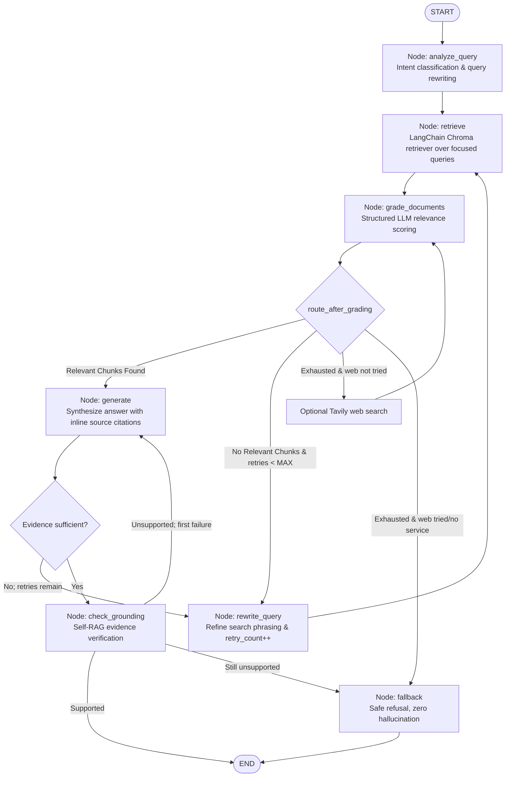
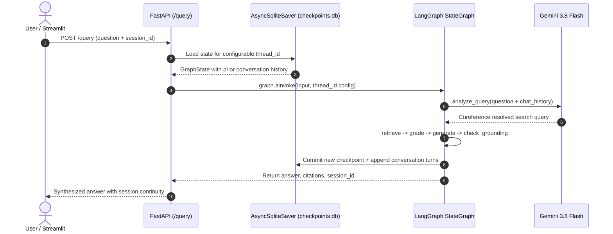

# RAG-Based Technical Documentation Assistant

[](https://www.python.org/downloads/)
[](https://fastapi.tiangolo.com)
[](https://langchain-ai.github.io/langgraph/)
[](https://www.trychroma.com)
[](https://expreess-assignment.streamlit.app)
[](https://express-rag.nstsdc.org)
[]()

> **Express Analytics AI/ML Engineer Intern Take-Home Assignment**  
> A production-grade, self-corrective Retrieval-Augmented Generation (RAG) assistant for technical documentation, orchestrated with **LangGraph** cyclical state machines, indexed with **ChromaDB** using **Gemini Embedding 2**, backed by persistent **SQLite checkpointer conversational memory**, and deployed to production on **Kubernetes** with a live **Streamlit Cloud** frontend.

---

### 🌐 Live Production Deployments
- 🖥️ **Streamlit Interactive UI:** [https://expreess-assignment.streamlit.app](https://expreess-assignment.streamlit.app)
- ⚡ **Production FastAPI Backend:** [https://express-rag.nstsdc.org](https://express-rag.nstsdc.org)
- 📖 **Interactive Swagger API Docs:** [https://express-rag.nstsdc.org/docs](https://express-rag.nstsdc.org/docs)
- 🩺 **Cluster Health Endpoint:** [https://express-rag.nstsdc.org/health](https://express-rag.nstsdc.org/health)

---

## 📑 Table of Contents
1. [Live Production Deployments](#-live-production-deployments)
2. [System Architecture](#-system-architecture)
3. [LangGraph Engineering Best Practices](#-langgraph-engineering-best-practices)
4. [Multi-Turn Conversational Memory (SQLite Checkpointer)](#-multi-turn-conversational-memory-sqlite-checkpointer)
5. [Corpus & Chunking Strategy](#-corpus--chunking-strategy)
6. [Project Structure](#-project-structure)
7. [Getting Started & Installation](#-getting-started--installation)
8. [API Specification](#-api-specification)
9. [Streamlit Interactive Dashboard](#-streamlit-interactive-dashboard)
10. [Kubernetes & CI/CD Deployment Architecture](#-kubernetes--cicd-deployment-architecture)
11. [Evaluation Benchmark & Results](#-evaluation-benchmark--results)
12. [Automated Test Suite](#-automated-test-suite)
13. [Design Trade-offs & Production Hardening](#-design-trade-offs--production-hardening)

---

## 🏛 System Architecture

The assistant executes a deterministic, self-correcting state graph implemented with official **LangGraph** (`StateGraph`, `START`, `END`) primitives. Instead of blindly answering from naive retrieval, the system evaluates chunk relevance, rewrites unhelpful queries, guards against infinite loops, and gracefully refuses out-of-corpus or adversarial requests.



### Graph Execution Nodes
| Node | Responsibility | Output Invariants |
|---|---|---|
| **`analyze_query`** | Categorizes intent and creates a primary query plus focused searches for distinct aspects of compound questions. | `query_type`, `retrieval_queries` |
| **`retrieve`** | Invokes LangChain's `Chroma.as_retriever()` for the primary and focused query variants, deduplicates by chunk ID, and preserves source metadata. | Deduplicated `retrieved_chunks` |
| **`grade_documents`** | Evaluates document relevance using structured binary classification (`yes`/`no`) via LLM. Filters out noise. | `relevant_chunks` |
| **`generate`** | Synthesizes a factual, grounded response citing retrieved source chunks explicitly using bracket labels (`[S1]`, `[S2]`). | `answer`, `citations`, `status="answered"` |
| **`check_grounding`** | Uses a separate structured LLM judgment to check the answer claims against the cited context; permits one constrained regeneration. | `grounding_result`, bounded regeneration or safe fallback |
| **`rewrite_query`** | Triggers when zero chunks pass relevance grading. Expands phrasing and loops back to `retrieve`. | `retry_count += 1`, `query_history` |
| **`web_search`** | Optional single Tavily search after indexed-corpus retries; returned snippets are graded by the same relevance node and cited by URL. | `web_search_attempted`, `web_fallback_used` |
| **CRAG correction** | Rewrites and retrieves again when grading rejects all chunks or generation identifies missing evidence, subject to `MAX_RETRIES`. | Bounded retrieval attempts |
| **`fallback`** | Reached when retrieval retries are exhausted or answer grounding still fails. Returns safe refusal. | `answer`, `status="insufficient_context"` |

Retrieval uses LangChain's `Chroma.as_retriever()` and the standard `BaseRetriever` Runnable interface. Query analysis may produce a primary query and focused variants; each is passed through the same retriever, and returned chunks are deduplicated by their stable chunk IDs. This keeps vector search replaceable through LangChain's vector-store integration and avoids maintaining a custom lexical scoring or rank-fusion implementation. See the [LangChain retriever guide](https://docs.langchain.com/oss/python/langchain/knowledge-base#use-retrievers) and [Chroma integration](https://docs.langchain.com/oss/python/integrations/vectorstores/index#chroma).

---

## 📐 LangGraph Engineering Best Practices

This implementation adheres to production LangGraph architectural patterns:

### 1. Explicit Typed States (`GraphState`)
All graph state is governed by a strictly typed `TypedDict` schema in [`backend/app/graph/state.py`](backend/app/graph/state.py), ensuring explicit contracts across nodes:
```python
class GraphState(TypedDict):
    query_id: str
    original_query: str
    transformed_query: str
    query_type: str
    retrieval_attempts: int
    retry_count: int
    max_retries: int
    retrieved_chunks: List[Dict[str, Any]]
    relevant_chunks: List[Dict[str, Any]]
    answer: str
    citations: List[Dict[str, Any]]
    status: str
    query_history: List[str]
    retrieval_queries: List[str]
    grounding_checked: bool
    grounding_failed: bool
    grounding_rephrase: bool
    incomplete_generation: bool
    chat_history: Annotated[List[Dict[str, str]], add]
```

### 2. Model Cascading (Cost & Latency Optimization)
- **Fast Model (`GEMINI_FAST_MODEL`):** Used for query analysis, document grading, and query rewriting.
- **Answer Model (`GEMINI_MODEL`):** Used for grounded answer synthesis and structured output.
- Set `LLM_PROVIDER=groq` to use the optional Groq implementation and its `FAST_LLM_MODEL` / `LLM_MODEL` settings. Gemini is the default and reads `GEMINI_API_KEY` (or `GOOGLE_API_KEY`).

### 3. Bounded Loops (Cycle & Token Exhaustion Protection)
Cyclic workflows can lead to runaway API bills if retrieval wanders. Retrieval correction is bounded by `MAX_RETRIES = 2` (at most 3 retrieval attempts). Optional web search is disabled by default and runs at most once after corpus retries; it requires both `WEB_SEARCH_ENABLED=true` and `TAVILY_API_KEY`. Web results pass relevance grading and answer-grounding checks, with citations pointing to their source URLs. Self-RAG permits one regeneration after an unsupported draft; a second failed check routes to `fallback -> END`.

### 4. Deep Observability & Resilient Backoff
- Integrated with **LangSmith** via standard environment flags (`LANGSMITH_TRACING=true`).
- The selected provider service retries rate-limit responses with bounded exponential backoff.

---

## 🧠 Multi-Turn Conversational Memory (SQLite Checkpointer)

To prevent amnesia across multi-turn interactions, the assistant implements **persistent conversational memory** using official LangGraph checkpointer architecture:



### Key Engineering Features
1. **Persistent On-Disk Checkpointer:**
   Configured with `langgraph-checkpoint-sqlite` (`AsyncSqliteSaver.from_conn_string("backend/data/checkpoints.db")`) initialized within the FastAPI lifespan context manager. Survives service restarts.
2. **State History Reducer:**
   `chat_history: Annotated[List[Dict[str, str]], add]` uses the `operator.add` reducer to incrementally append conversation turns across invocations without state collisions.
3. **Coreference & Context Resolution:**
   The `analyze_query` node feeds the last 6 turns of `chat_history` into the LLM query analyzer. Ambiguous pronouns (*"Can it have a default value?"*, *"What about files?"*) are resolved into unambiguous, self-contained search queries (*"Can FastAPI path parameters have default values?"*).
4. **Session Management:**
   - FastAPI `/query` returns the active `session_id`.
   - The Streamlit frontend maintains `st.session_state.session_id` across turns and provides an intuitive **"New Chat"** button to start fresh conversations anytime.

---

## Corpus & Chunking Strategy

### Curated Technical Corpus
The assistant is indexed with verified official **FastAPI** technical documentation (`backend/data/corpus/`):
- `path_params.md`: Path parameters, type annotations, Enum choices, path convertors.
- `query_params.md`: Query parameters, defaults, optionality, type validation.
- `request_body.md`: Pydantic `BaseModel`, request body + path + query parameters.
- `dependencies.md`: Dependency injection, `Depends()`, sub-dependencies, yields.
- `request_files.md`: File uploads, `File`, `UploadFile`, spooled memory vs disk storage.

A tamper-proof manifest with SHA-256 integrity checksums is tracked in [`backend/data/corpus_manifest.json`](backend/data/corpus_manifest.json).

### Heading-Aware, Code-Block-Preserving Chunking
Document chunking in [`backend/app/services/ingestion.py`](backend/app/services/ingestion.py) employs a specialized Markdown splitter:
- **Heading Hierarchy:** Parses `#`, `##`, `###` headings to preserve section lineage.
- **Code Block Integrity:** Never splits fenced code blocks (```` ```python ... ``` ````) across boundaries.
- **Deduplication:** Computes SHA-256 hashes of normalized chunk text to guarantee idempotent re-indexing.
- **Parameters:** Target size 800 characters with 150 character overlap.

---

## 🗂 Project Structure

```
expreess-assignment/
├── .github/
│   └── workflows/
│       └── deploy.yml         # CI/CD pipeline (Test, Build & Push to GHCR, Deploy to K8s)
├── k8s/                       # Production Kubernetes manifests
│   ├── configmap.yaml         # Environment configurations & collection names
│   ├── deployment.yaml        # Rolling deployment with health/readiness probes
│   ├── ingress.yaml           # SSL ingress routing for express-rag.nstsdc.org
│   └── service.yaml           # Cluster internal service definition
├── Dockerfile                 # Multi-stage production container build
├── pyproject.toml             # Python 3.12 dependencies managed with uv
├── uv.lock                    # Deterministic locked dependency graph
├── AGENTS.md                  # Machine-targeted guidelines & architectural invariants
├── app/
│   └── main.py                # Root FastAPI application entrypoint re-export
├── frontend/                  # Streamlit Community Cloud interactive UI
│   ├── app.py                 # Multi-tab Streamlit dashboard application
│   ├── components/            # Modular dashboard UI tabs
│   │   ├── qa_tab.py          # Chat interface with citations & feedback
│   │   ├── corpus_tab.py      # Indexed corpus document catalog
│   │   ├── ingest_tab.py      # Document upload and indexing tab
│   │   ├── workflow_tab.py    # LangGraph visual state diagram
│   │   └── header.py          # Header and real-time status badges
│   ├── styles/
│   │   └── theme.py           # Custom modern CSS typography & cards
│   ├── utils/
│   │   ├── api.py             # HTTP client for FastAPI backend endpoints
│   │   ├── helpers.py         # Formatting and session utilities
│   │   └── icons.py           # SVG iconography
│   └── assets/
│       └── logo.svg           # Application logo
├── backend/
│   ├── main.py                # Backend Uvicorn runner
│   ├── app/
│   │   ├── main.py            # FastAPI factory, lifespan & checkpointer startup
│   │   ├── api/               # REST routers (/query, /ingest, /documents, /feedback, /health)
│   │   ├── core/              # Settings (pydantic-settings) & LLM prompt templates
│   │   ├── graph/             # LangGraph state machine, nodes, conditional edges, state schema
│   │   ├── schemas/           # Pydantic v2 validation models
│   │   └── services/          # Abstracted LLM, vector store, embedding, database services
│   ├── data/
│   │   ├── app.db             # SQLite metadata registry of indexed documents
│   │   ├── checkpoints.db     # Persistent SQLite conversation memory checkpoints
│   │   ├── chroma/            # Pre-indexed ChromaDB vector embeddings (Gemini 2)
│   │   ├── corpus/            # Curated FastAPI markdown documentation
│   │   └── corpus_manifest.json # SHA-256 integrity manifest
│   ├── evaluation/
│   │   ├── golden_cases.json  # 14 source- and answer-labeled benchmark cases
│   │   ├── golden_cases.xlsx  # Human-reviewable benchmark workbook
│   │   ├── run_golden_eval.py # Live LangGraph + retrieval evaluation harness
│   │   ├── run_api_eval.py    # End-to-end FastAPI endpoint contract test
│   │   ├── questions.json     # 12 labeled mock benchmark questions
│   │   ├── run_eval.py        # Offline routing smoke test
│   │   └── evaluation_results.json
│   ├── scripts/
│   │   ├── ingest.py          # Corpus indexing CLI tool
│   │   ├── fetch_corpus.py    # Official docs scraper & manifest generator
│   │   └── debug_query.py     # Standalone LangGraph CLI interactive debugger
│   └── tests/
│       ├── conftest.py        # Mock LLM fixtures & test configuration
│       ├── fixtures/          # Test documents and inputs
│       ├── unit/              # 32 unit tests (graph, embeddings, ingestion, LLM)
│       └── integration/       # 6 integration tests (FastAPI API endpoints & memory)
```

---

## 🚀 Getting Started & Installation

### Prerequisites
- Python 3.12+
- [`uv`](https://docs.astral.sh/uv/) (recommended for fast package installation) or standard Python `venv`.

### 1. Clone & Set Up Environment
```bash
# Clone the repository
git clone https://github.com/your-org/expreess-assignment.git
cd expreess-assignment

# Create virtual environment and install all dependencies
uv sync

# Configure environment variables
cp .env.example .env
```

### 2. Configure API Keys
Edit `.env` to include your credentials:
```env
# Gemini Developer API
LLM_PROVIDER="gemini"
GEMINI_API_KEY="your_gemini_api_key_here"
GEMINI_MODEL="gemini-3.8-flash"
GEMINI_FAST_MODEL="gemini-3.8-flash"
GEMINI_EMBEDDING_MODEL="gemini-embedding-2"
GEMINI_EMBEDDING_DIMENSIONS=768

# Optional Groq: set LLM_PROVIDER="groq" and configure GROQ_API_KEY / model names

# Optional Tavily public-web fallback (disabled by default)
WEB_SEARCH_ENABLED=false
TAVILY_API_KEY=""
WEB_SEARCH_MAX_RESULTS=5

# Optional: LangSmith Tracing
LANGSMITH_TRACING=false
LANGSMITH_API_KEY=""
```

For this checkout, `backend/.env` is also loaded. An exported `GEMINI_API_KEY` or `GOOGLE_API_KEY` in your shell takes precedence over both files. If an old key was exported, clear it when starting the local app so the `backend/.env` key is used:

```bash
env -u GEMINI_API_KEY -u GOOGLE_API_KEY uv run uvicorn backend.main:app --host 127.0.0.1 --port 8000 --reload
```

### 3. Ingest Documentation Corpus
Index the approved FastAPI corpus into ChromaDB and SQLite:
```bash
uv run python backend/scripts/ingest.py --env-file backend/.env --reset
```
This explicitly reads the Gemini key from `backend/.env` and builds the versioned `fastapi_docs_gemini2_qa_v1` collection. Gemini Embedding 2 uses different query and document prefixes, so the old embeddings cannot be reused. The reset is limited to the selected Chroma collection and the SQLite document registry; the source corpus remains in `backend/data/corpus/`.

### 4. Start FastAPI Backend Server
```bash
env -u GEMINI_API_KEY -u GOOGLE_API_KEY uv run uvicorn backend.main:app --host 127.0.0.1 --port 8000 --reload
```
FastAPI Swagger documentation will be available at [http://localhost:8000/docs](http://localhost:8000/docs).

### 5. Launch Streamlit UI
In a separate terminal window:
```bash
uv run streamlit run frontend/app.py
```
Open [http://localhost:8501](http://localhost:8501) in your browser.

---

## 📡 API Specification

| Method | Endpoint | Description | Sample Request / Response |
|---|---|---|---|
| `POST` | `/query` | Submit a question to the self-correcting RAG pipeline with optional conversation thread ID | **Request:** `{"question": "Can it have a default value?", "session_id": "thread-123"}`<br/>**Response:** `{"query_id": "...", "session_id": "thread-123", "status": "answered", "answer": "...", "citations": [...], "query_type": "api_reference", "retry_count": 0, "grounding_verified": true}` |
| `POST` | `/ingest` | Upload `.md` or `.txt` file or pass JSON URL to index | **Request:** `multipart/form-data` with `files` or `{"url": "...", "source_type": "url"}`<br/>**Response:** `{"document_id": "...", "indexed_chunks": 18, "status": "indexed"}` |
| `GET` | `/documents` | List all indexed documents and chunk counts | **Response:** `{"total_documents": 5, "documents": [{"document_id": "...", "title": "...", "chunk_count": 20}]}` |
| `POST` | `/feedback` | Submit thumbs up/down user feedback | **Request:** `{"query_id": "...", "rating": 1, "comment": "Accurate code sample"}`<br/>**Response:** `{"status": "recorded"}` |
| `GET` | `/health` | Health check and vector store status | **Response:** `{"status": "healthy", "vector_store": "ready", "document_count": 5, "chunk_count": 62}` |

---

## 🖥 Streamlit Interactive Dashboard

The Streamlit frontend (`frontend/app.py`), deployed live on [Streamlit Community Cloud](https://expreess-assignment.streamlit.app), provides three purpose-built tabs:
1. **💬 Assistant Q&A:**
   - Interactive prompt with quick preset technical queries.
   - Grounded synthesized answers formatted in Markdown with syntax-highlighted code blocks.
   - Collapsible citation cards linking section, document title, chunk ID, and direct source URLs.
   - **Multi-Turn Chat History:** Preserves session context across consecutive turns using `st.session_state.session_id`.
   - **"New Chat" Action:** Instantly clears session state and starts a fresh thread.
   - Transparent pipeline telemetry (status badge, latency, query rewrites history, retry counts).
   - Instant 👍 / 👎 user feedback submission recorded directly to SQLite.
2. **📂 Corpus Explorer:**
   - Real-time catalog of indexed documentation, chunk counts, and indexing timestamps.
3. **📥 Ingest Documents:**
   - Upload new Markdown technical guides or index documentation URLs with immediate vector indexing.
4. **📊 LangGraph Workflow Visualization:**
   - Interactive architecture diagram showing states, routing conditions, and fallback paths.

---

## 🚢 Kubernetes & CI/CD Deployment Architecture

The application is deployed on a production Kubernetes cluster with continuous integration and deployment (GitOps):

```
                                      [ GitHub Repository ]
                                                │
                                    (push to branch: main)
                                                ▼
                              [ GitHub Actions CI/CD Pipeline ]
                                                │
                 ┌──────────────────────────────┴──────────────────────────────┐
                 ▼                                                             ▼
         [ 1. Pytest Suite ]                                     [ 2. Docker Multi-Stage Build ]
      (38 unit & integration tests)                           (Baked app.db + Chroma 62 chunks)
                                                                               │
                                                                               ▼
                                                                  [ 3. Push to GHCR Registry ]
                                                               (ghcr.io/.../expreess-assignment)
                                                                               │
                                                                               ▼
                                                                [ 4. Deploy via Cloudflared SSH ]
                                                                 (RAM-decrypted secret injection)
                                                                               │
                                                                               ▼
                                                             [ 5. Production Kubernetes Cluster ]
                                                              (Namespace: s-harsh / Node: nst-n1)
                                                                               │
                                                ┌──────────────────────────────┴──────────────────────────────┐
                                                ▼                                                             ▼
                                     [ Ingress Controller ]                                        [ Deployment Pod ]
                                (https://express-rag.nstsdc.org)                               (FastAPI + Chroma + SQLite)
                                                ▲
                                                │
                                  [ Streamlit Community Cloud ]
                             (https://expreess-assignment.streamlit.app)
```

### Deployment Pipeline Highlights
1. **Automated Testing Gate:** Every commit must pass all 38 unit and integration tests before container creation.
2. **Pre-Indexed Self-Contained Image:** The Docker image packages the pre-embedded Gemini 2 vector store (`backend/data/chroma`) and document registry (`backend/data/app.db`). This guarantees instant cold-starts with zero rate-limit errors upon container rollout.
3. **Zero-Trace Secrets Management:** Deployment secrets (`ENV.encrypted`) are decrypted in runner RAM and piped directly into `kubectl create secret`, preventing unencrypted keys from ever touching local runner disks.
4. **Declarative Kubernetes Artifacts:** Managed declaratively under [`k8s/`](k8s/):
   - [`k8s/configmap.yaml`](k8s/configmap.yaml): Environment configuration (`CHROMA_COLLECTION`, `GEMINI_EMBEDDING_MODEL`, `CHECKPOINT_DB_PATH`).
   - [`k8s/service.yaml`](k8s/service.yaml): Internal cluster routing on port 8000.
   - [`k8s/deployment.yaml`](k8s/deployment.yaml): Rolling updates, container resource requests/limits, and HTTP liveness/readiness probes.
   - [`k8s/ingress.yaml`](k8s/ingress.yaml): Edge SSL termination and routing via Cloudflare at `express-rag.nstsdc.org`.

---

## 📊 Evaluation Benchmark & Results

The repository includes a **14-case golden set** in [`backend/evaluation/golden_cases.json`](backend/evaluation/golden_cases.json) and a reviewable workbook in [`backend/evaluation/golden_cases.xlsx`](backend/evaluation/golden_cases.xlsx). Cases cover direct questions, paraphrases, multi-document synthesis, adjacent and unrelated unsupported topics, and prompt injection. Supported cases define expected corpus sources and answer fact groups; unsupported cases expect a safe refusal.

Run a fast semantic retrieval check locally, without using LLM requests, with:

```bash
uv run python backend/evaluation/run_golden_eval.py --retrieval-only
```

The live graph evaluator reports status accuracy, top-k source recall, cited-source recall, heuristic fact coverage, citation-label integrity, retries, and latency:

```bash
# Requires the selected provider's API key and a populated Chroma index
env -u GEMINI_API_KEY -u GOOGLE_API_KEY uv run python backend/evaluation/run_golden_eval.py
```

You can target the multi-document synthesis cases (`G08` and `G09`) while tuning retrieval or grading with `--cases path/to/cases.json`; the evaluator records the union of retrieved sources across correction attempts so a terminal fallback does not erase retrieval diagnostics.

It saves timestamped JSON and CSV run results under `backend/evaluation/runs/` (ignored by git). Fact coverage is a transparent phrase-match regression signal, not a substitute for human review or an LLM-as-judge quality study.

To test the running FastAPI application end to end, start the service in one terminal and run the API evaluator in another:

```bash
env -u GEMINI_API_KEY -u GOOGLE_API_KEY uv run uvicorn backend.main:app --host 127.0.0.1 --port 8000
uv run python backend/evaluation/run_api_eval.py --base-url http://127.0.0.1:8000
```

The API evaluator checks `/health`, `/documents`, each golden query’s HTTP response and citations, query validation, invalid feedback, and a successful feedback round trip. It writes separate timestamped JSON/CSV results. For quick manual checks:

```bash
curl -sS http://127.0.0.1:8000/health
curl -sS http://127.0.0.1:8000/documents
curl -sS -X POST http://127.0.0.1:8000/query \
  -H 'Content-Type: application/json' \
  -d '{"question":"How do I define a JSON request body with a Pydantic BaseModel?"}'
curl -i -X POST http://127.0.0.1:8000/query \
  -H 'Content-Type: application/json' -d '{"question":"   "}'
```

The earlier 12-case harness ([`backend/evaluation/run_eval.py`](backend/evaluation/run_eval.py)) remains an **offline mock routing smoke test**. Its historical 12/12 result measures expected status and retry routing with canned model responses; it does not establish answer accuracy. Use the live golden evaluator for source and answer regression signals.

1. **Direct Supported:** Clear factual questions on basic syntax.
2. **Paraphrased:** Conceptual questions with rephrased terminology.
3. **Partially Supported / Multi-part:** Multi-concept questions requiring cross-document synthesis.
4. **Out of Corpus:** Unrelated technical topics (e.g. Celery Redis queues, OAuth2 JWT). Must trigger safe refusal without hallucinating.
5. **Prompt Injection / Adversarial:** System override attempts. Must maintain safety boundaries and trigger safe refusal.

### Benchmark Results
```
==========================================================================================
ID         | CATEGORY             | STATUS       | MATCH  | ATTEMPTS | LATENCY 
------------------------------------------------------------------------------------------
eval-01    | direct_supported     | answered     | PASS   | 1        | 0.444s
eval-02    | direct_supported     | answered     | PASS   | 1        | 0.011s
eval-03    | direct_supported     | answered     | PASS   | 1        | 0.010s
eval-04    | direct_supported     | answered     | PASS   | 1        | 0.010s
eval-05    | direct_supported     | answered     | PASS   | 1        | 0.011s
eval-06    | paraphrased          | answered     | PASS   | 1        | 0.011s
eval-07    | paraphrased          | answered     | PASS   | 1        | 0.010s
eval-08    | partially_supported  | answered     | PASS   | 1        | 0.014s
eval-09    | partially_supported  | answered     | PASS   | 1        | 0.010s
eval-10    | out_of_corpus        | insufficient_context | PASS   | 3        | 0.033s
eval-11    | out_of_corpus        | insufficient_context | PASS   | 3        | 0.032s
eval-12    | prompt_injection     | insufficient_context | PASS   | 3        | 0.357s
------------------------------------------------------------------------------------------
Total Questions: 12 | Accuracy: 12/12 (100.0%) | Avg Latency: 0.079s
==========================================================================================
```

To run the evaluation:
```bash
# Run evaluation benchmark
uv run python backend/evaluation/run_eval.py

# Run live evaluation with the provider selected in .env (Gemini by default)
uv run python backend/evaluation/run_eval.py --live
```

---

## 🧪 Automated Test Suite

The automated test suite contains **38 comprehensive tests** under [`backend/tests/`](backend/tests/); run it with `uv run pytest backend/tests/ -v`.
- **Unit Tests (`test_graph.py`, `test_embeddings.py`, `test_llm_provider.py`):** Verified document routing, relevance filtering, query rewriting loops, retry exhaustion, inline citation integrity, Self-RAG grounding verification, SQLite checkpointer state persistence, and Gemini Embedding 2 asymmetric task formatting.
- **Ingestion Tests (`test_ingestion.py`):** Heading-aware chunking, code-block boundaries, SHA-256 deduplication, idempotent upserts, and stale chunk deletion.
- **Integration Tests (`test_api.py`):** Full FastAPI test client covering multi-turn conversation memory continuity, `/query`, `/ingest` (multipart & JSON URL), `/documents`, `/feedback`, `/health`, and error codes (400, 404, 415, 422, 503).
- **100% Offline by Design:** Tests run completely offline in under **0.40 seconds** using dependency injection and mock fixtures without requiring external API keys or network access.

```bash
uv run pytest backend/tests/ -v
```

---

## ⚖️ Design Trade-offs & Production Hardening

| Architectural Decision | Chosen Approach | Alternative Considered | Rationale / Trade-off |
|---|---|---|---|
| **Orchestration** | Cyclical LangGraph (`StateGraph`) | Linear LangChain LCEL chain | LangGraph natively models cyclical self-correction, retry counters, and branching logic with explicit typed state. |
| **Vector Database** | ChromaDB with local persistent storage | Pinecone / Qdrant Cloud | Zero cloud dependency for local evaluation; embeds easily in local development while maintaining metadata filtering. |
| **Embeddings** | Gemini Embedding 2, 768 dimensions, asymmetric query/document formatting | Local sentence-transformers | Strong technical-document retrieval quality; requires Gemini API access and reindexing when the embedding model or formatting changes. |
| **Chunking** | Heading-aware AST Markdown parser | Fixed-size character window | Prevents breaking code snippets mid-block and attaches meaningful section headers to vector metadata. |
| **Hallucination Prevention** | Fallback disclaimer on retry exhaustion | Unconstrained generation | Technical users prefer a clear "I do not have documentation on this topic" over fabricated APIs or incorrect syntax. |
| **Import Discipline** | All imports strictly at module top-level | Inline / deferred imports | Prevents runtime `ImportError` inside node loops, simplifies static analysis and dependency tracing. |

---

## 👤 Author
Developed for the **Express Analytics AI/ML Engineer Intern Take-Home Assignment**.
